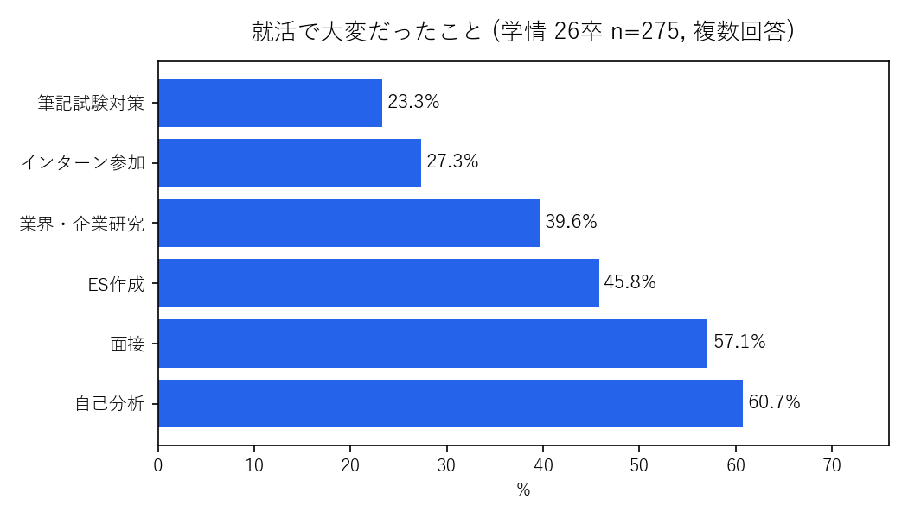
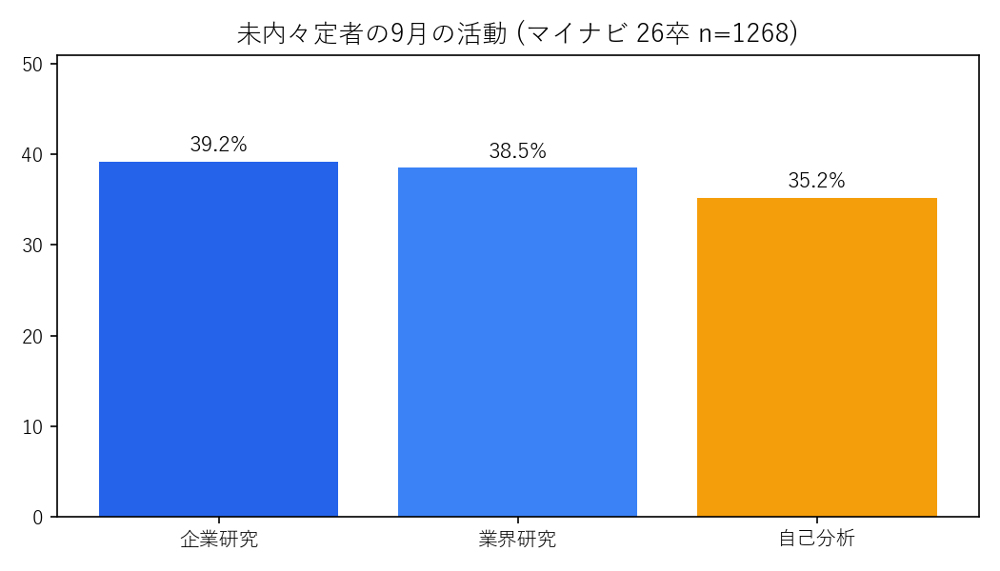

# 自己分析データ集（全数値・出典付き）

## 1. 学情 26卒 275名（2025.8.20-9.2）
- 大変だったこと: 自己分析60.7%, 面接57.1%, ES45.8%, 業界・企業研究39.6%, インターン27.3%, 筆記23.3%
- 頑張って良かった: 自己分析46.5%, 面接対策42.5%, ES31.3%, 業界研究31.3%
- 出典: https://service.gakujo.ne.jp/wp-content/uploads/2025/09/250930-navienq.pdf

## 2. dodaキャンパス 317名（2026.6.23-30）/ 239名（2026.4.3-8）
- ESで最も重要: 自己分析42.6%
- 自己PRは自己分析をもとに41%
- 開始時期: 3年4-6月35%（＝65%は夏以降）
- 手法: ツール30%, 自分史21%, MBTI10%
- 社会人124名: 入社後ギャップ40%
- 出典: https://campus.doda.jp/career/self-analysis/000335.html

## 3. マイナビ 26卒 1268名（2025.9.23-27）
- 未内々定者の9月活動: 企業研究39.2%, 業界研究38.5%, 自己分析35.2%
- 出典: https://career-research.mynavi.jp/reserch/20251010_103406/

## 4. Synergy Career 26・27卒 200名（2025.11.19-23）
- 適職診断経験53.0%（0回47%, 1回17%, 2-4回20%, 5-9回10%, 10回以上6%）
- 自己イメージ一致58.3%, 信頼できる30.5%, どちらともいえない42.0%
- 業界選びに影響36.8%
- 出典: https://prtimes.jp/main/html/rd/p/000000069.000065508.html

## 5. 就職白書2026（就職みらい研究所）
- 企業1182社: 採用基準「人柄」重視93.8%
- 学生1326人: アピール アルバイト46.1%, 人柄40.9%
- AI利用840人: 自己分析57.1%, 自己PR55.4%
- 出典: https://jbrc.recruit.co.jp/common/images/mirai/uploads/2026/02/hakusho2026_data.pdf
- 解説: https://kigyobunseki.com/column/jiko-bunseki-dekinai

## 6. 納得内定（内定後の納得感）— 追加データ（2026.10）
| 指標 | 数値 | 出典 |
|---|---|---|
| 入社先に100%完全納得の就活生 | 19%（納得度50%以下が38.6%） | ABABA総研 内定者300名（2025.9.8-13） |
| 安易に決めてしまったと感じる（2025年卒） | 43.6%（重視基準が分からなかった学生は65.8%） | 就職白書2025 | 
| なんとなく納得しないまま内定承諾 | 29.7%（承諾後もエントリー継続22.0%） | ABABA 同上 |
| 当初からの第一志望群で入社決定（2023年卒） | 61.5%（2014年卒32.6%から上昇） | 就職みらい研究所 振り返り調査 |
- 出典1: https://prtimes.jp/main/html/rd/p/000000107.000068609.html
- 出典2: https://jbrc.recruit.co.jp/data/data20250220_4795.html
- 出典3: https://diamond.jp/articles/-/336642
- 補足: 内定率そのものは10月時点で92-94%（キャリタス92.3%／IRP93.9%）と過去最高 ＝「内定は取れるが納得は2割前後」のギャップが問題の影響面で効く
- 対比フレーズ: 「内定率94%なのに、完全納得は19%」

### 6-1. 納得感を裏付ける行動データ（他社ソース）
| 指標 | 数値 | 出典 |
|---|---|---|
| 内定辞退率（2025年卒・卒業時点） | 63.8%（2023年卒65.8%から高止まり） | 就職みらい研究所 就職プロセス調査 |
| 内定辞退率（2026年卒・2025.9時点） | 63.9%（平均内定取得2.52社で辞退率上昇） | 就職みらい研究所 同上 |
| 内定辞退経験がある学生 | 62.6% | MusePass 学生調査 |
| 辞退理由1位 | 「より志望度の高い企業から内定が出た」49.8% | マイナビ 企業調査（2026年卒） |
| 意味 | 「ベターな内定を他に探し続ける」＝ある内定で納得しきれない学生が6割超 | — |
- 出典: https://ordenar-consul.com/contents/118427 ／ https://www.fukuri-chubu.net/blog/96 ／ https://career-research.mynavi.jp/column/20260316_108862 ／ https://www.musepass.jp/info/research_1
- 使い分け: 「納得度19%」（ABABA）が直接値、内定辞退率63.8%は「納得できず手放す/選び続ける」行動の裏取りに使える

## 問題定義一文
> 本来は全員が十分な自己理解で挑むべきにもかかわらず、やり方とゴールが分からないために、6割が苦戦したまま選考に進んでしまうことが問題である。
